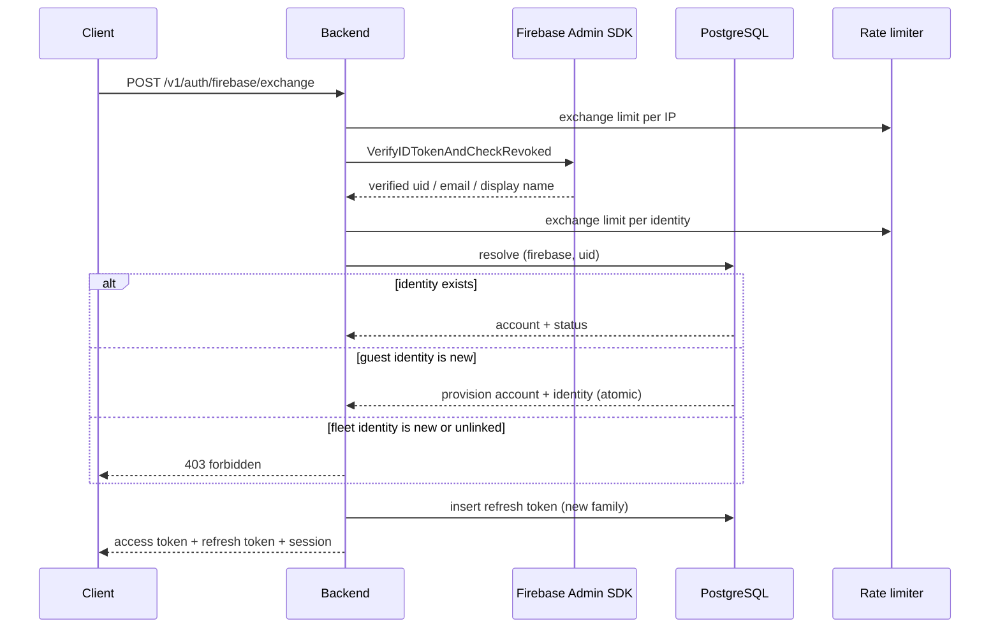

# Authentication Flow

This document explains how cloud authentication works in the Tycoon backend. Firebase is the
identity provider for Guest Mobile and Fleet Console. The backend verifies Firebase credentials
once, maps the verified identity to a stable internal account, and then issues its own short-lived
access token and rotating refresh token.

The Hub does not use this flow. Hub authentication stays offline and independent; Firebase ID
Tokens and backend session tokens are never synchronized to the Hub.

## 1. Concepts

| Concept | Description |
|---|---|
| Firebase identity | A verified Firebase `uid` stored in `account_identities` with `provider = 'firebase'`. It is the only trusted external identity key. |
| Internal account | A stable `accounts.id` UUID. Access tokens use it as the `sub` claim. It never changes when identities are linked or unlinked. |
| Account identity link | A unique `(provider, provider_sub)` association between a Firebase identity and one internal account. |
| Session family | A login session represented by a `refresh_tokens.family_id`. Every refresh rotation creates a new token in the same family. Families are independently revocable per device/client. |
| Access token | A short-lived backend-signed JWT (RS256). It proves an active backend session for protected API calls. |
| Refresh token | An opaque, high-entropy, single-use credential. Only its SHA-256 hash is stored. |
| Administrator grant | A backend-owned `admin_users` record linked to the internal account. It supplies Fleet Console role, tenant, and ship scope. Firebase claims never grant this authority. |

Guest Mobile and Fleet Console can share one internal account while keeping separate sessions. A
Firebase sign-in never grants Fleet Console access by itself; an existing active administrator grant
must be linked to the account.

## 2. Authentication Modes

`AUTH_MODE` selects how protected `/v1` routes resolve a principal.

| Mode | Protected API credential | Use |
|---|---|---|
| `dev` | `X-Dev-Principal: <entry>` checked against `AUTH_DEV_PRINCIPALS` | Local development and tests only. The backend does not accept backend access tokens in this mode. |
| `jwt` | `Authorization: Bearer <backend-access-token>` | Firebase SSO flow used by Guest Mobile and Fleet Console. |

`AUTH_MODE=dev` is rejected when `APP_ENV=production`. `dev` mode requires a non-empty
`AUTH_DEV_PRINCIPALS` allowlist.

The authentication HTTP endpoints are still mounted in both modes. Use `jwt` mode to exercise the
complete Firebase exchange and backend-token flow.

## 3. Components

| Component | Responsibility | Source |
|---|---|---|
| HTTP handlers | Decode requests, set no-store headers, map service errors to API errors. | `internal/auth/handlers.go` |
| Auth service | Exchange, refresh, logout, logout-all, link, unlink orchestration. | `internal/auth/service.go` |
| Firebase verifier | Verifies Firebase ID Tokens with the Firebase Admin SDK, including revocation checks. | `internal/auth/firebase.go` |
| Access token issuer | Issues and validates RS256 JWTs, including issuer, audience, TTL, clock skew, and token type checks. | `internal/auth/tokens.go` |
| Signing key set | Resolves the active signing key and publishes public JWKS keys. | `internal/auth/signing.go` |
| Refresh token utilities | Generate opaque refresh tokens and SHA-256 hashes, calculate expiry, create family IDs. | `internal/auth/refresh.go` |
| Store | Transactional persistence for identities, accounts, refresh-token rotation, and audit rows. | `internal/auth/store.go` |
| Rate limiter | Enforces per-minute limits in memory (development/test) or Redis (staging/production). | `internal/auth/ratelimit.go` |
| Bearer middleware | Resolves a principal from the request and stores it in the context. | `internal/httpserver/middleware/auth.go` |

Startup wiring lives in `cmd/server/main.go` and `cmd/server/auth.go`. Configuration validation
lives in `internal/config/config.go`, so the auth service can trust validated configuration.

## 4. API Surface

| Method | Path | Authentication | Purpose |
|---|---|---|---|
| `POST` | `/v1/auth/firebase/exchange` | Public | Exchange a Firebase ID Token for backend tokens. |
| `POST` | `/v1/auth/refresh` | Public | Rotate a refresh token and issue new backend tokens. |
| `POST` | `/v1/auth/logout` | Public | Revoke the current session family. |
| `POST` | `/v1/auth/logout-all` | Backend access token | Revoke every session for the account. |
| `POST` | `/v1/auth/identities/link` | Backend access token | Link a fresh Firebase identity to the account. |
| `DELETE` | `/v1/auth/identities/{identityId}` | Backend access token | Unlink an identity from the account. |
| `GET` | `/v1/auth/jwks` | Public | Publish public access-token verification keys. |

## 5. Exchange Flow

`POST /v1/auth/firebase/exchange` is the only point where a Firebase ID Token is accepted.



### 5.1 Request

```http
POST /v1/auth/firebase/exchange
Content-Type: application/json
```

```json
{
  "firebase_id_token": "<firebase-id-token>",
  "client": "guest_mobile"
}
```

`client` is optional and defaults to `guest_mobile`. The allowed values are `guest_mobile` and
`fleet_console`.

### 5.2 Processing steps

1. Decode the request and normalize the client. Missing ID tokens and invalid clients are rejected.
2. Apply the exchange rate limit per IP address.
3. Verify the Firebase ID Token with the Firebase Admin SDK. Signature, issuer, audience, expiry,
   not-before, and revocation are checked. Verification failure returns a generic `401`.
4. Apply the exchange rate limit per verified Firebase `uid`.
5. Resolve `(firebase, uid)`:
   - Existing identity: load the account and require `status = 'active'` with `deleted_at IS NULL`.
   - Unknown guest identity: provision exactly one active guest account plus one identity link in a
     single transaction. A verified email is stored only when verified and conflict-free.
   - Unknown guest identity whose verified email already belongs to another account: create nothing
     and return `409 identity_link_required`. Accounts are never merged or linked by email.
   - Unknown or unlinked Fleet Console identity: return `403`. Fleet access is never auto-provisioned.
   - `fleet_console` with an existing account but no active administrator grant: return `403`.
6. Issue an RS256 access token with `sub = account_id` and the requested `client`.
7. Generate a new opaque refresh token, hash it, and insert it with a new `family_id` and `client`.
8. Write an `auth.session.issued` audit row and return the token response.

### 5.3 Response

```json
{
  "token_type": "Bearer",
  "access_token": "<backend-access-token>",
  "expires_in": 900,
  "refresh_token": "<opaque-refresh-token>",
  "session": {
    "session_id": "<family-uuid>",
    "account_id": "<account-uuid>",
    "client": "guest_mobile",
    "access_expires_at": "2026-11-08T12:00:00Z",
    "refresh_expires_at": "2026-12-08T12:00:00Z"
  }
}
```

The Firebase ID Token is not returned, stored as a session credential, or logged. Exchange responses
are marked `Cache-Control: no-store`.

## 6. Protected API Authentication

Clients send only the backend access token:

```http
GET /v1/ships
Authorization: Bearer <backend-access-token>
```

In `jwt` mode the middleware calls `AccessTokenProvider.Authenticate`:

1. Extract the bearer token.
2. Validate the JWT:
   - algorithm is RS256;
   - `kid` selects the verification key;
   - issuer and audience match configuration;
   - `exp` is required and not expired;
   - `iat` is valid and clock skew is applied;
   - `typ = access`, `client` is valid, `jti` is present;
   - `sub` is a UUID;
   - token lifetime does not exceed 15 minutes.
3. Load the account and require it to be active and not deleted.
4. Build the principal from backend records:
   - `guest_mobile` becomes `Principal{actor_type: account, actor_id: account_id}` with no tenant
     authority.
   - `fleet_console` requires an active administrator grant and becomes
     `Principal{actor_type: admin, actor_id: admin_users.id, tenant_id, role, ship_ids}`.
5. Store the principal in the request context. Authorization policies use only this principal.

Account status and Fleet grant scope are re-read on every request. Suspension, deletion, role
removal, or ship-scope removal takes effect on the next request, not only after token expiry.
Firebase custom claims are never copied into the principal.

## 7. Refresh Flow

`POST /v1/auth/refresh` rotates the refresh token on every successful call.

```mermaid
sequenceDiagram
    participant Client
    participant API as Backend
    participant DB as PostgreSQL

    Client->>API: POST /v1/auth/refresh {refresh_token}
    API->>API: hash token; apply IP and session limits
    API->>DB: lookup token hash
    alt token already used or revoked
        API->>DB: revoke entire family (atomic)
        API-->>Client: 401 authentication failed
    else token is valid
        API->>DB: lock row; verify account/grant; insert replacement
        API->>DB: mark old token used and link replacement
        API-->>Client: new access token + new refresh token
    end
```

### 7.1 Processing steps

1. Apply the refresh rate limit per IP address.
2. Hash the presented refresh token and apply the refresh rate limit per session hash.
3. Look up the token hash. Unknown tokens return a generic `401`.
4. Reject non-account subjects, invalid clients, expired tokens, and inactive accounts with a generic
   `401`.
5. If the token was already used or revoked, atomically revoke the entire family and audit
   `auth.session.reuse_detected`. The caller receives a generic `401`.
6. For Fleet Console sessions, require an active administrator grant.
7. Issue a new access token and a new opaque refresh token.
8. In one transaction: lock the presented row, re-check state, insert the replacement in the same
   family, mark the old row used with `replaced_by`, and audit `auth.session.refreshed`.

The old refresh token becomes unusable immediately. Clients must serialize refresh per session. Two
concurrent refreshes with the same token result in at most one success; the other is treated as
reuse and revokes the family.

## 8. Logout and Logout-All

### 8.1 Logout

`POST /v1/auth/logout` takes the current refresh token and revokes its entire session family.

```json
{"refresh_token": "<current-refresh-token>"}
```

The operation is idempotent and returns `204` for a well-formed request, including unknown, expired,
or already-revoked tokens. It does not call Firebase and does not sign the user out of Firebase.

### 8.2 Logout all sessions

`POST /v1/auth/logout-all` requires a backend access token. It revokes every refresh-token family for
the authenticated account, including Guest Mobile and Fleet Console sessions for that account. Other
accounts are unaffected. It is idempotent and returns `204`.

The user may still be signed in to Firebase until the client performs Firebase sign-out separately.

## 9. Identity Linking and Unlinking

These endpoints require a backend access token. The account is always taken from the authenticated
principal, never from the request body.

### 9.1 Link

`POST /v1/auth/identities/link` accepts a freshly verified Firebase ID Token:

```json
{"firebase_id_token": "<fresh-firebase-id-token>"}
```

Behavior:

- Links `(firebase, uid)` to the authenticated account.
- Repeating the same link for the same account is idempotent (`200`).
- An identity already linked to another account returns `409 identity_conflict` and changes nothing.
- The account identifier remains stable.
- Linking is rate-limited per account and audited.

Email is not used to resolve or merge accounts. An unknown identity whose email matches an existing
account receives `409 identity_link_required` on exchange and must use this explicit link flow.

### 9.2 Unlink

`DELETE /v1/auth/identities/{identityId}` removes an identity owned by the authenticated account.

Behavior:

- Removing the last usable sign-in identity returns `409 last_identity`.
- An identity not owned by the account returns `404 not_found`.
- Successful and rejected attempts are audited.

## 10. Signing Keys and JWKS

Access tokens are signed with RS256. The JWT header carries the key identifier (`kid`).

- Development/test may use a local RSA key file or an in-memory random key.
- Staging/production must use KMS keys configured through `AUTH_SIGNING_KMS_KEYS`; the active key is
  selected by `AUTH_SIGNING_ACTIVE_KID`.
- `GET /v1/auth/jwks` publishes public RSA parameters (`kty`, `kid`, `use`, `alg`, `n`, `e`) for the
  active key and any retained rotation keys. Private material is never exposed.
- JWKS is publicly cacheable (`Cache-Control: public, max-age=300`).
- During rotation, keep the previous public key available for at least the access-token lifetime
  (15 minutes); 24 hours is recommended.

## 11. Tokens

### 11.1 Access token claims

| Claim | Meaning |
|---|---|
| `iss` | Configured backend issuer (`AUTH_TOKEN_ISSUER`). |
| `aud` | Configured audience (`AUTH_TOKEN_AUDIENCE`). |
| `sub` | Internal account UUID. Never a Firebase `uid`. |
| `iat` | Issued-at time. |
| `exp` | Expiry. At most 15 minutes after `iat`. |
| `jti` | Unique token ID. |
| `typ` | Must be `access`. |
| `client` | `guest_mobile` or `fleet_console`. |

Access tokens contain no roles, tenant or ship assignments, Firebase tokens, refresh tokens, or
personal data beyond what is listed. Authorization context is resolved from the database on each
request.

### 11.2 Refresh token storage

- Generated from 32 random bytes and encoded as base64url.
- Only the SHA-256 hash is stored in `refresh_tokens.token_hash`.
- Each token belongs to a `family_id` and a `client`.
- A successful refresh marks the old row `used_at` and points `replaced_by` at the replacement.
- Reuse of a used or revoked token revokes the whole family.

## 12. Rate Limits

Limits are enforced per one-minute window. Development/test use the in-memory backend; staging and
production require Redis so limits are shared across instances.

| Endpoint | Scope | Default per minute |
|---|---|---|
| Exchange | IP address | 10 |
| Exchange | Firebase identity | 30 |
| Refresh | IP address | 60 |
| Refresh | Session hash | 30 |
| Link/unlink | Account | 10 |
| Logout-all | Account | 5 |

Exceeding a limit returns `429` with a `Retry-After` header. If the limiter is unavailable, the
request fails closed with `503 auth_unavailable`; protection is never silently disabled.

## 13. Error Mapping

| Condition | Status | Code |
|---|---|---|
| Invalid/missing credential, unknown/expired/revoked refresh token, inactive account, Fleet grant missing on refresh | `401` | `unauthorized` |
| New guest identity email collision | `409` | `identity_link_required` |
| Identity already linked elsewhere | `409` | `identity_conflict` |
| Unlinking the last identity | `409` | `last_identity` |
| Identity not owned/found | `404` | `not_found` |
| Fleet Console client not permitted/no active grant on exchange | `403` | `forbidden` |
| Rate limit exceeded | `429` | `rate_limited` |
| Firebase, rate limiter, or signing material unavailable | `503` | `auth_unavailable` |
| Malformed/validation error | `400`/`422` | shared validation codes |

Error messages are deliberately generic. Clients must not infer whether a Firebase user, account, or
session exists from the error response.

## 14. Audit Events

Security-relevant auth actions append to `audit_log`:

| Action | Trigger |
|---|---|
| `auth.identity.provisioned` | New guest account and identity created. |
| `auth.identity.linked` | Identity linked to an account. |
| `auth.identity.unlinked` | Identity removed from an account. |
| `auth.identity.link_rejected` | Link rejected (conflict or inactive account). |
| `auth.identity.unlink_rejected` | Unlink rejected (last identity or not owner). |
| `auth.session.issued` | Exchange created a session. |
| `auth.session.refreshed` | Refresh rotated a token. |
| `auth.session.reuse_detected` | Reuse detected; family revoked. |
| `auth.session.revoked` | Logout revoked a family. |
| `auth.session.revoked_all` | Logout-all revoked every family for an account. |
| `auth.admin.access_denied` | Fleet exchange/refresh denied. |

Audit details contain only non-secret metadata such as client, provider, and a closed-set reason.
Raw tokens, token hashes, Firebase tokens, and signing keys are never written to audit rows or logs.

## 15. Configuration

Auth configuration is read only from process environment variables. See `.env.example` for the full
list and defaults.

| Variable | Purpose |
|---|---|
| `AUTH_MODE` | `dev` or `jwt`. |
| `AUTH_DEV_PRINCIPALS` | Dev-mode principal allowlist. |
| `AUTH_TRUST_PROXY` | Parsed configuration flag reserved for proxy trust handling. |
| `AUTH_FIREBASE_PROJECT_ID` | Firebase project. Required in `jwt` mode. |
| `AUTH_FIREBASE_CREDENTIALS_FILE` | Firebase service account file. Required in staging/production. |
| `FIREBASE_AUTH_EMULATOR_HOST` | Local Firebase Auth emulator. Allowed only in development/test. |
| `AUTH_TOKEN_ISSUER` | Access-token `iss`. |
| `AUTH_TOKEN_AUDIENCE` | Access-token `aud`. |
| `AUTH_ACCESS_TTL` | Access-token lifetime, at least 1s and at most 15m. |
| `AUTH_REFRESH_TTL` | Refresh-token lifetime, default 720h (30 days). |
| `AUTH_CLOCK_SKEW` | JWT clock-skew allowance, default 60s. |
| `AUTH_SIGNING_MODE` | `local` or `kms`. |
| `AUTH_SIGNING_ACTIVE_KID` | Key ID used for new tokens. |
| `AUTH_SIGNING_KMS_KEYS` | Comma-separated `kid=arn` KMS keys. |
| `AUTH_SIGNING_LOCAL_KEY_FILE` | Development-only PEM key file. |
| `AUTH_SIGNING_LOCAL_KID` | Key ID for the local signer. |
| `AUTH_RATE_LIMIT_BACKEND` | `memory` or `redis`. |
| `AUTH_RATE_LIMIT_REDIS_URL` | Redis connection URL for shared limits. |
| `AUTH_RATE_LIMIT_REDIS_PREFIX` | Redis key prefix. |
| `AUTH_RATE_LIMIT_*_PER_MIN` | Per-endpoint rate limits. |

Fail-fast rules include:

- `AUTH_MODE=dev` is rejected in production.
- `AUTH_MODE=jwt` requires a Firebase project.
- The Firebase emulator is rejected outside development/test.
- Staging/production require KMS signing, Firebase credentials, Redis, and rate limits at or above
  the documented minimums.
- Local signing material and local key files are rejected in staging/production.
- KMS mode requires keys and an active key that references one of them.
- Redis mode requires a URL and prefix.

## 16. Local Development

There are two ways to exercise protected APIs locally.

### 16.1 Dev allowlist mode

Set `AUTH_MODE=dev` and a non-empty `AUTH_DEV_PRINCIPALS`, then send the matching header:

```bash
curl -H "X-Dev-Principal: system:dev-1:00000000-0000-0000-0000-000000000000" \
  http://localhost:8080/v1/tenants
```

This bypasses the Firebase exchange flow and backend access tokens.

### 16.2 Full Firebase SSO flow

Use `AUTH_MODE=jwt`, the Firebase Auth emulator, and a local RSA signing key. The complete local
walkthrough, including creating a test Firebase user and exchanging its ID Token, is in
[`specs/003-firebase-sso-auth/quickstart.md`](../specs/003-firebase-sso-auth/quickstart.md).

Minimum local `jwt` configuration:

```dotenv
APP_ENV=development
AUTH_MODE=jwt
AUTH_FIREBASE_PROJECT_ID=demo-tycoon
FIREBASE_AUTH_EMULATOR_HOST=localhost:9099
AUTH_TOKEN_ISSUER=http://localhost:8080
AUTH_TOKEN_AUDIENCE=tycoon-api
AUTH_SIGNING_MODE=local
AUTH_SIGNING_ACTIVE_KID=local-dev-1
AUTH_SIGNING_LOCAL_KID=local-dev-1
AUTH_SIGNING_LOCAL_KEY_FILE=/tmp/tycoon-auth-dev-key.pem
AUTH_RATE_LIMIT_BACKEND=redis
AUTH_RATE_LIMIT_REDIS_URL=redis://localhost:6379/0
```

## 17. Client Rules

Clients must:

- Exchange a Firebase ID Token only to establish or re-establish a backend session.
- Send the backend access token on protected APIs, never the Firebase ID Token.
- Store the refresh token only in secure platform storage and serialize refresh operations.
- Replace both tokens after every successful refresh and never reuse an old refresh token.
- Treat `401` on refresh as a revoked/expired session and require a new Firebase sign-in.
- Call Firebase sign-out separately from backend logout.
- Never place tokens in URLs, logs, analytics, crash reports, or insecure browser storage.

The full client contract is in
[`specs/003-firebase-sso-auth/contracts/client-integration.md`](../specs/003-firebase-sso-auth/contracts/client-integration.md).

## 18. Hub Boundary

The onboard Hub keeps its own offline authentication:

- It verifies signed boarding passes and creates local sessions without Firebase or cloud access.
- It never calls Firebase and never obtains a Firebase ID Token.
- Firebase ID Tokens, backend access tokens, and backend refresh tokens are not included in snapshot,
  change-log, or sync payloads.

Cloud authentication changes must not introduce a Firebase or backend-session dependency into the
Hub.

## References

- Feature specification: `specs/003-firebase-sso-auth/spec.md`
- Implementation plan: `specs/003-firebase-sso-auth/plan.md`
- Data model: `specs/003-firebase-sso-auth/data-model.md`
- Client integration contract: `specs/003-firebase-sso-auth/contracts/client-integration.md`
- Local validation guide: `specs/003-firebase-sso-auth/quickstart.md`
- API contract: `openapi/openapi.yaml`
- Architecture: `docs/system-architecture.md`
